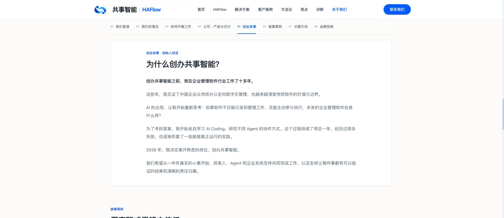

# 关于我们长文排版修正

用户反馈短标题占左栏、长正文占右栏造成大片空白。本次只调整 about.module.css：责任理念、创业故事和长期方向使用上下连续排版，标题及正文共享 800px 阅读宽度；正文 16px、1.9 行高，段间距 16px；首屏身份区垂直居中。

品牌文案、八章节导航、公司产品关系及其他页面保持原有内容。

## 验证与发布

- 隔离目录与服务器候选 Next.js 构建通过，ESLint 通过，百度推送测试 3/3。
- 本地、服务器候选和公网：八章节文案及导航、12 个静态资源检查通过；SEO 8/8，覆盖 38 个页面。
- 浏览器桌面 1920px、手机 390px：无横向溢出，章节导航吸顶位置分别 72px、64px；创业故事标题与正文上下排列，浏览器错误日志为空。
- BUILD_ID：CKTBW63QPAu9oQ5dyH5nk
- 构建清单 SHA256：1226cf00c862c75742de38f3cb215518cf0ad272570252b5bb5362574dc76bcc
- 发布目录：/opt/haflow-releases/about-reading-20261013
- 激活前后源码与构建校验通过；PM2 online；错误日志 76918 字节，未增长。
- 回滚：bash /opt/haflow-releases/about-reading-20261013/rollback.sh

仅上传 CSS。共享工作区既有未提交修改没有被一并发布或提交。

